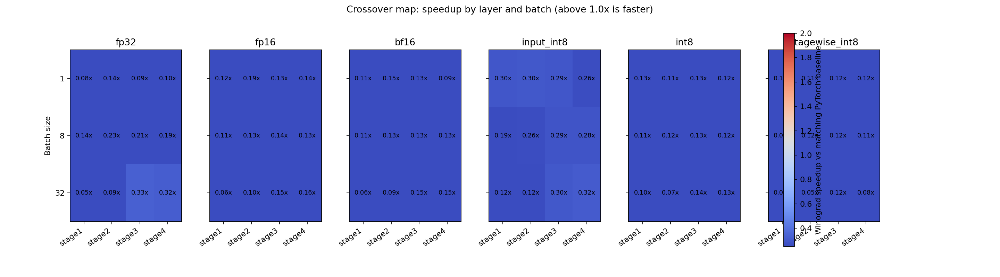
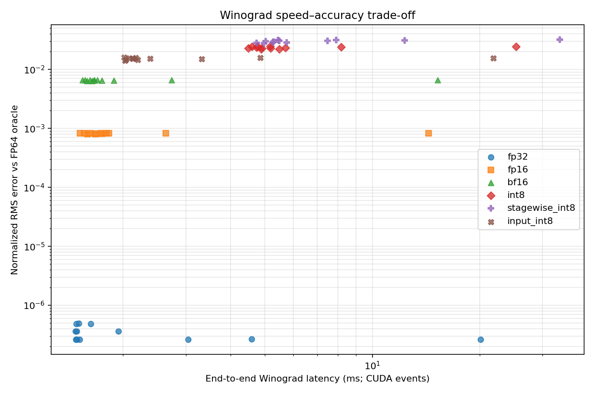
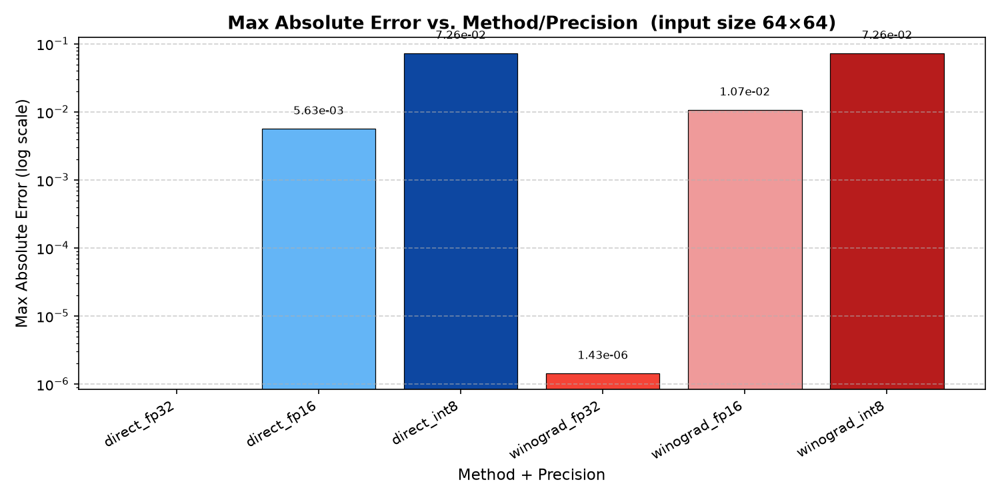
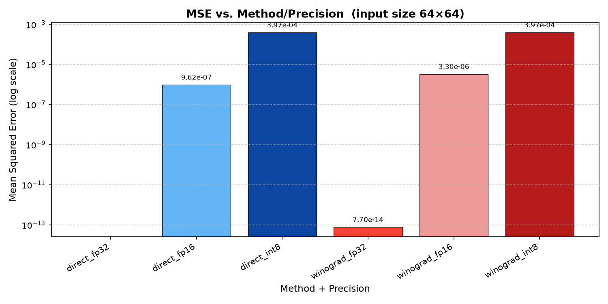
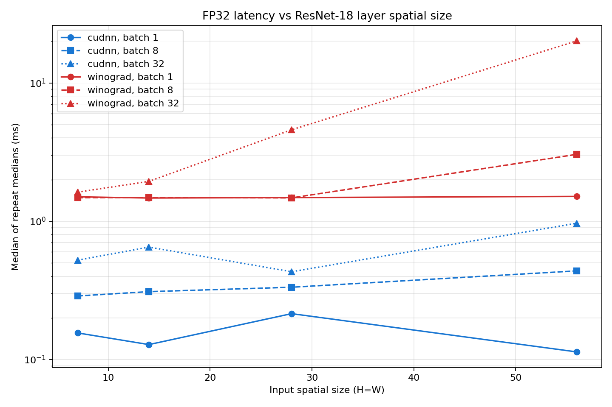

# Winograd reduced-precision study

## Executive summary

**Result: 0 of 72 Winograd configurations met both requirements.** 0/72 were faster than the matching PyTorch/cuDNN precision baseline, while 13/72 met the max-absolute-error budget of 0.1. Figures are embedded below; runtime is not treated as a power or energy proxy.

## 1. Question and decision rule

The question is whether F(2x2,3x3) Winograd convolution can reduce end-to-end execution time without exceeding an explicit numerical-error budget. A configuration is worthwhile only when both conditions hold:

1. `speedup = matching-baseline latency / Winograd latency > 1.0`.
2. `maximum absolute error <= 0.1` against the FP64 convolution oracle.

**Conclusion:** multiplication-count savings alone are not a performance result. The benchmark includes transforms, padding, allocations, and matrix multiplications.

## 2. Experimental setup

- Vectorized PyTorch NCHW Winograd: filter transform, vectorized input tiles, 16 batched channel-reduction GEMMs, inverse transform, and output crop; zero padding is supported.
- Baselines: PyTorch `conv2d` (cuDNN on CUDA) in FP32, FP16, BF16, and input-quantized FP32; NumPy direct cross-correlation is measured separately for a single-channel sanity case.
- Ground truth: PyTorch convolution with FP64 input and weights on CPU. Reported relative error is mean elementwise absolute error divided by `|reference| + 1e-8`; normalized RMS is RMS error divided by reference RMS.
- INT8 Winograd quantizes transformed U and V independently per Winograd coordinate, accumulates the channel reduction in int32, and dequantizes for the inverse transform. `stagewise_int8` additionally requantizes the transformed product. `input_int8` is only a quantize-before-transform comparator, not an integer Winograd implementation.
- Quantization scales are dynamically calibrated from each input/weight batch (max-absolute by transform coordinate unless an explicit percentile is supplied to the API); this is not learned clipping or a reproduction of Wino Vidi Vici training.
- Coverage: 4 spatial sizes (7x7, 14x14, 28x28, 56x56), batch sizes 1, 8, 32, 6 Winograd precision modes, and 72 Winograd configurations.
- Layer shapes are representative ResNet-18 3x3 stage convolutions. Reported latency covers the complete PyTorch function; CUDA events time GPU execution. Each cell records repeat count and latency spread.
- Inputs and filters use seeded standard-normal values; accuracy results are synthetic layerwise measurements, not real ResNet activations.
- Operation counts use the slide's per-2x2-tile arithmetic convention (direct: 36 multiplies and 32 additions; Winograd: 16 multiplies and 56 additions), excluding transform and filter-preparation work. Direct counts use the exact cropped output area; Winograd counts include partially cropped edge tiles. Counts are not latency predictions.

## 3. Run metadata

- Device: NVIDIA GeForce RTX 4060 Laptop GPU
- NVIDIA driver: 591.66
- PyTorch / CUDA runtime / cuDNN: 2.5.1+cu121 / 12.1 / 90100
- GPU clock / temperature / board-power sample before the sweep: 210 / 405 MHz; 47 C; 3.87 W
- Telemetry is a single pre-sweep `nvidia-smi` sample (not synchronized with timed kernels or integrated energy); no energy claim is made.

## 4. Numerical results and calculations

### Step 1 — Operation-count change

For one 2x2 output tile, direct convolution uses 36 multiplies and 32 additions; Winograd uses 16 multiplies and 56 additions. This is `(36 - 16) / 36 = 55.6%` fewer multiplications and `(56 - 32) / 32 = 75.0%` more additions, before accounting for transforms and data movement.

For `stage1`, batch 1, FP32, the CSV records 115,605,504 direct multiplies versus 51,380,224 Winograd Hadamard multiplies (55.6% fewer), and 102,760,448 direct additions versus 179,830,784 Winograd additions (+75.0%).

**Conclusion:** fewer counted multiplications did not by itself establish a latency win.

### Step 2 — End-to-end latency

`speedup = baseline latency / Winograd latency`. For the same representative case: `0.1134 ms / 1.5105 ms = 0.0751x`, or about `13.3x` slower end to end.

The best measured speedup was 0.335x (stage3, batch 32, fp32).

**Conclusion:** none of the tested configurations reduced measured latency.

### Step 3 — Accuracy and precision aggregates

Maximum absolute error must be at most 0.1. `Faster`, `within budget`, and `worthwhile` are counts out of `N` for each precision.

| Precision | N | Mean speedup | Best speedup (layer, batch) | Faster | Within budget | Worthwhile | Mean normalized RMS | Mean MSE | Worst max error | Mean latency (ms) |
|---|---:|---:|---|---:|---:|---:|---:|---:|---:|---:|
| fp32 | 12 | 0.165x | 0.335x (stage3, N=32) | 0 | 12 | 0 | 3.445e-07 | 1.665e-10 | 1.640e-04 | 3.477 |
| fp16 | 12 | 0.130x | 0.192x (stage2, N=1) | 0 | 1 | 0 | 8.199e-04 | 6.749e-04 | 1.969e-01 | 2.811 |
| bf16 | 12 | 0.118x | 0.149x (stage2, N=1) | 0 | 0 | 0 | 6.559e-03 | 4.322e-02 | 1.570e+00 | 2.881 |
| input_int8 | 12 | 0.253x | 0.316x (stage4, N=32) | 0 | 0 | 0 | 1.525e-02 | 2.354e-01 | 3.617e+00 | 4.098 |
| int8 | 12 | 0.118x | 0.139x (stage3, N=32) | 0 | 0 | 0 | 2.354e-02 | 5.732e-01 | 6.460e+00 | 6.949 |
| stagewise_int8 | 12 | 0.102x | 0.125x (stage3, N=1) | 0 | 0 | 0 | 3.008e-02 | 9.182e-01 | 6.590e+00 | 8.603 |

**Conclusion:** FP32 met the error budget in all its cases but never ran faster. FP16 passed the error screen in only 1/12 cases; BF16 and the INT8 variants passed in none.

### Step 4 — Apply both decision conditions

- Faster than matching baseline: **0/72**.
- At or below the max-error budget: **13/72**.
- Passing both conditions: **0/72**.

**Conclusion:** no tested configuration is eligible under the stated rule.

## 5. Result figures

### Speedup by layer, batch, and precision

Each heatmap cell is Winograd speedup over the matching baseline. Values above 1.0x would be faster; the maximum observed value is 0.335x.

**Conclusion:** no measured crossover exceeds 1.0x.

### Accuracy versus runtime

Lower error and lower latency are preferable. FP32 has mean normalized RMS error 3.445e-07, but remains slower than its baseline; the INT8 variants have greater numerical error and no speed win.

**Conclusion:** no tested precision offers both the required accuracy and an end-to-end speed improvement.

### Maximum absolute error by method and precision

The dashed horizontal line marks the max-error budget; boxplots summarize measured shapes and methods.

**Conclusion:** judge each precision against the numeric threshold; reduced precision is not automatically acceptable.

### Mean squared error by method and precision

MSE complements maximum error by summarizing squared deviations across outputs.

**Conclusion:** MSE and maximum error reveal different aspects of error; the pass/fail rule here uses maximum error.

### FP32 latency versus spatial size

The plot compares cuDNN and Winograd across measured layer sizes and batches; Winograd latency includes its transforms.

**Conclusion:** results should not be extrapolated beyond the tested shapes, batches, and device.

## 6. Overall conclusion

**0 of 72 configurations met both criteria.** The 55.6% theoretical reduction in tile-level multiplications did not translate into an end-to-end speedup for this unfused implementation. A fused CUDA/Triton kernel and calibrated representative activations are reasonable next experiments before making a hardware-level claim.

## 7. Limitations

- The crossover is hardware-, shape-, batch-, and precision-dependent; these timings are specific to this run.
- Pre-sweep GPU clocks were 210/405 MHz; clocks were not sampled during timed kernels.
- FP16/BF16 run in the requested PyTorch tensor dtype. INT8 paths are quantization simulations, not dedicated accelerator kernels.
- The 0.1 max-error budget is a numerical screening threshold, not a validated CNN-accuracy or task-quality limit.
- No CNN was trained or evaluated; no top-1 accuracy, ResNet end-to-end inference, or model-level quality claim is supported.
- Winograd transform additions and filter-transform amortization are omitted from operation counts, but their runtime cost is included.

## Reproducibility

Run `python main.py --runs 100 --repeats 5` to regenerate the complete benchmark and report, or `python main.py --plot-only` to rebuild plots and this report from the saved CSV. Fixed seeds are recorded per row. Use a plugged-in performance-mode laptop and repeat after cooling for publication-quality comparisons.

## References

1. A. Lavin and S. Gray, “Fast Algorithms for Convolutional Neural Networks,” CVPR 2016, https://arxiv.org/abs/1509.09308.
2. E. Mori et al., “Wino Vidi Vici: Conquering Numerical Instability of 8-Bit Winograd Convolution,” WACV 2024.
3. Y. Gupta et al., “Deep Learning with Limited Numerical Precision,” ICML 2015, https://proceedings.mlr.press/v37/gupta15.html.
